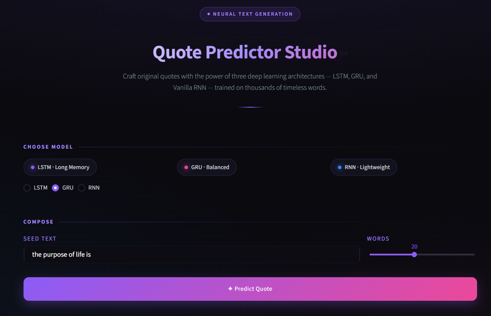
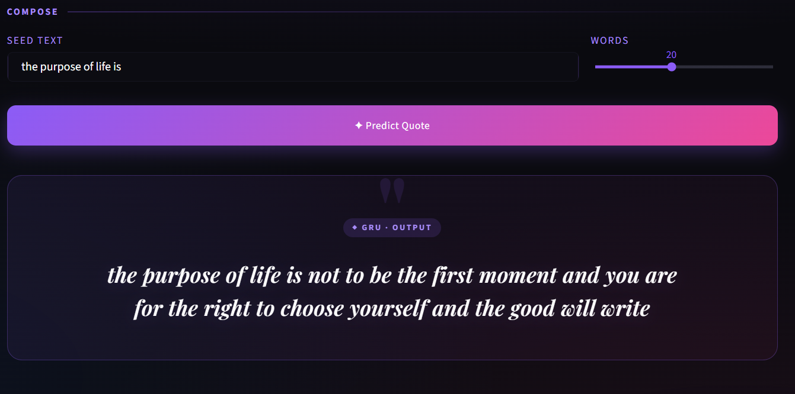

<div align="center">

# ✨ Quote Generator

### *Where words meet neural networks*

An AI-powered quote generation web app that uses **LSTM**, **GRU**, and **Vanilla RNN** architectures to craft original, meaningful quotes from a seed text.

<br/>

[](https://vani-verse-vault-quill-studio.onrender.com/)
[](https://github.com/Adarsh-SSingh/Quote-Predictor)

<br/>


</div>

---

## 📸 Preview

<div align="center">

### 🖥️ App Interface

<!-- Add your Screenshots -->


<br/>

### ✨ Generated Quote Demo

<!-- Add your Screenshots -->


</div>

> 💡 **Tip:** Add your screenshots to `assets/` folder and update paths.

---

## 🎯 Overview

**Quote Generator** is an end-to-end deep learning project that generates original quotes using recurrent neural networks. It compares three popular sequence models — **LSTM**, **GRU**, and **Vanilla RNN** — trained on a dataset of 3,000+ timeless quotes.

Users can:
- 🎨 Enter any seed text (e.g., *"the purpose of life is"*)
- 🧠 Choose between three deep learning architectures
- ⚡ Control the number of words to generate
- 📖 Get instant AI-generated quotes

---

## 🧠 Model Architectures

<div align="center">

| Model | Full Form | Strength | Parameters |
|:-----:|:----------|:---------|:----------:|
| 🟣 **LSTM** | Long Short-Term Memory | Captures long-term dependencies | ~2.6M |
| 🩷 **GRU** | Gated Recurrent Unit | Faster training, balanced performance | ~2.0M |
| 🔵 **RNN** | Vanilla Recurrent Network | Lightweight, quick predictions | ~1.3M |

</div>

### 🏗️ Common Architecture

```
┌─────────────────────────────────────────┐
│  Embedding Layer                        │
│  vocab_size = 10,000  →  dim = 50       │
└──────────────────┬──────────────────────┘
                   │
┌──────────────────▼──────────────────────┐
│  LSTM / GRU / SimpleRNN                 │
│  units = 128                            │
└──────────────────┬──────────────────────┘
                   │
┌──────────────────▼──────────────────────┐
│  Dense Layer                            │
│  units = 10,000  →  softmax             │
└─────────────────────────────────────────┘
```

---

## 🛠️ Tech Stack

<div align="center">

| Layer | Technology |
|:-----:|:-----------|
| **Deep Learning** | TensorFlow 2.15 · Keras |
| **Web Framework** | Streamlit 1.32 |
| **Data Processing** | NumPy · Pandas |
| **Training Env** | Google Colab (T4 GPU) |
| **Deployment** | Render |
| **Version Control** | Git · GitHub |

</div>

---

## 📁 Project Structure

```
Quote-Prediction/
│
├── 📁 .streamlit/
│   └── ⚙️  config.toml                # Streamlit theme config
│
├── 📁 Data/
│   └── 📊 qoute_dataset.csv           # Training dataset (3,038 quotes)
│
├── 📁 models/                         # Trained model artifacts
│   ├── 🧠 lstm_model.h5
│   ├── 🧠 rnn_model.h5
│   ├── 🧠 gru_model.h5
│   ├── 🔤 tokenizer.pkl
│   └── 📏 max_len.pkl
│
├── 📁 Notebook/
│   └── 📓 codefile.ipynb              # Complete training workflow
│
├── 🐍 app.py                          # Streamlit web application
├── 📋 requirements.txt                # Python dependencies
├── 🚫 .gitignore                      # Git ignore rules
└── 📖 README.md                       # This file
```

---

## 🚀 Run Locally

### 1️⃣ Clone the Repository

```bash
git clone https://github.com/Adarsh-SSingh/Quote-Predictor.git
cd Quote-Predictor
```

### 2️⃣ Create Virtual Environment

```bash
python -m venv venv

# Windows
venv\Scripts\activate

# Mac / Linux
source venv/bin/activate
```

### 3️⃣ Install Dependencies

```bash
pip install --upgrade pip
pip install -r requirements.txt
```

### 4️⃣ Launch the App

```bash
streamlit run app.py
```

App opens at **http://localhost:8501** 🎉

---

## 📊 Training Pipeline

<details>
<summary><b>🔍 Click to expand the full pipeline</b></summary>

<br/>

### Step 1 — Data Loading
- 3,038 quotes loaded from CSV
- Columns: `quote`, `Author`

### Step 2 — Preprocessing
- Lowercase conversion
- Punctuation removal via `str.maketrans`
- Applied to all quotes

### Step 3 — Tokenization
- Keras `Tokenizer` with `num_words=10,000`
- Total unique tokens: **8,978**

### Step 4 — Sequence Generation
- n-gram style input-output pairs
- Generated **85,271** training samples

### Step 5 — Padding
- Max sequence length: **745**
- Padding type: `pre`

### Step 6 — Model Training
- Optimizer: `Adam`
- Loss: `categorical_crossentropy`
- Batch size: `128`
- Epochs: `100`
- Validation split: `10%`

### Step 7 — Model Export
- Saved as `.h5` (HDF5 format)
- Tokenizer + max_len saved via `pickle`

</details>

### 📈 Training Results

<div align="center">

| Model | Train Accuracy | Val Accuracy | Train Loss |
|:-----:|:--------------:|:------------:|:----------:|
| 🟣 LSTM | 73.6% | 7.5% | 1.20 |
| 🩷 GRU | 76.2% | 7.4% | 1.01 |
| 🔵 RNN | 74.5% | 6.9% | 1.07 |

</div>

> ⚠️ **Note:** Low validation accuracy is expected in text generation tasks. The model learns statistical patterns rather than exact predictions. Output quality is evaluated subjectively.

---

## ✨ Features

<div align="center">

| Feature | Description |
|:-------:|:------------|
| 🎨 **Glassmorphic UI** | Modern dark theme with gradients and blur effects |
| 🎯 **Three Models** | LSTM, GRU, RNN — switch instantly |
| ⚡ **Real-time Generation** | Instant text output |
| 📱 **Responsive** | Works on mobile and desktop |
| ✨ **Animated Cards** | Smooth hover and fade animations |
| 📅 **Auto Year Footer** | Dynamically updates |

</div>

---

## 🔮 Roadmap

- [ ] 🎛️ Add temperature parameter for creativity control
- [ ] 🌍 Multi-language support
- [ ] 📸 Export quotes as images
- [ ] 🔍 Beam search for better text quality
- [ ] 🎨 Light / Dark theme toggle
- [ ] 📥 Download quotes as text

---

## 🤝 Contributing

Contributions are welcome! Feel free to:

1. Fork the repository
2. Create your feature branch (`git checkout -b feature/amazing`)
3. Commit your changes (`git commit -m 'Add amazing feature'`)
4. Push to the branch (`git push origin feature/amazing`)
5. Open a Pull Request

---

## 👤 Author

<div align="center">

**Adarsh Singh**

[](https://github.com/Adarsh-SSingh)
[](https://www.linkedin.com/in/adarsh--ssingh/)

</div>

---

## 📄 License

This project is licensed under the **MIT License** — free to use, modify, and distribute.

---

<div align="center">

### 🌟 If you liked this project, please give it a star!


<br/><br/>

**Made with ❤️ using TensorFlow & Streamlit**


</div>